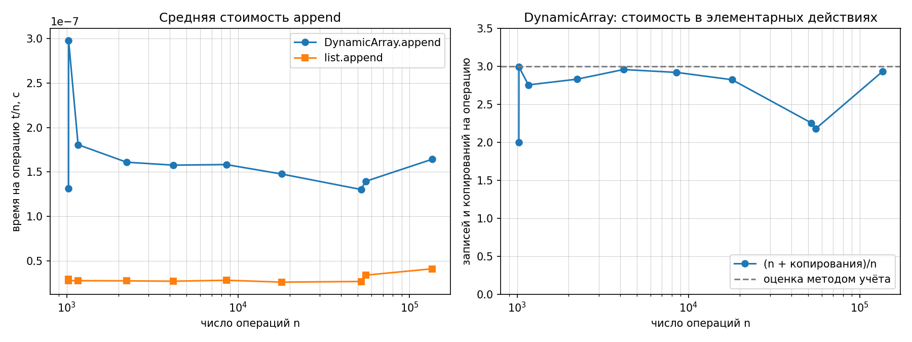
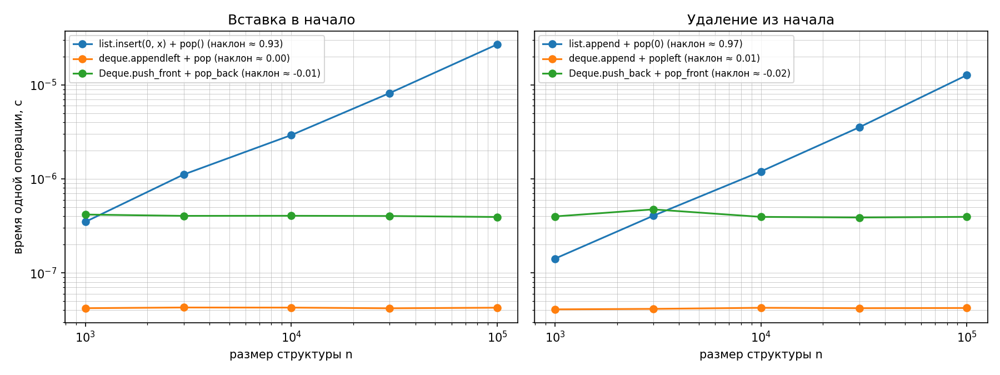

# Лабораторная работа №2

## Реализация рекурсивных функций и динамического массива, стека и дека

- **Вариант:** 1
- **Seed генератора:** 31
- **Язык программирования:** Python 3.11.9
- **Процессор:** AMD Ryzen 7 5800H with Radeon Graphics
**Операционная система:** Windows, PowerShell

## 1. Цель работы

Освоить построение рекурсивных алгоритмов и реализацию линейных структур
данных. Исследовать стоимость наивной рекурсии и мемоизации, реализовать
динамический массив с автоматическим увеличением ёмкости, стек и дек на
собственных структурах данных. Проверить корректность реализаций на
граничных и случайных тестах, сравнить их со стандартными структурами
Python и экспериментально подтвердить теоретические оценки сложности.

## 2. Реализация и аналитическая оценка сложности

### 2.1. Рекурсивные функции

#### Факториал

Функция `factorial(n)` вычисляет факториал неотрицательного целого
числа:

**n! = 1 при n = 0; n \* (n - 1)! при n \> 0.**

Базовое условие `n == 0` завершает рекурсию. На каждом следующем шаге
аргумент уменьшается на единицу.

Рекуррентное соотношение для времени выполнения:

`T(n) = T(n - 1) + Θ(1)`.

Следовательно, временная сложность составляет **Θ(n)**. Глубина стека
рекурсивных вызовов также линейна, поэтому дополнительная память
составляет **Θ(n)**.

Область определения реализованной функции — целые числа `n≥ 0`.

#### Числа Фибоначчи без мемоизации

Функция `fib_naive(n)` использует рекуррентное определение:

**F(n) = n при n \< 2; F(n) = F(n - 1) + F(n - 2) при n ≥ 2.**

При каждом вызове для `n≥ 2` создаются два рекурсивных вызова. Одни и те
же значения вычисляются многократно. Например, при вычислении `F(5)`
значение `F(3)` требуется в нескольких ветвях рекурсии.

Рекуррентное соотношение:

`T(n) = T(n - 1) + T(n - 2) + Θ(1)`.

Количество вызовов растёт экспоненциально. Более точная оценка временной
сложности — **Θ(φⁿ)**, где `φ=(1+sqrt(5))/2`; часто также используют
верхнюю оценку `O(2^n)`.

Число вызовов функции для `n≥ 0`:

`C_naive(n) = 2 * F(n + 1) - 1`.

Глубина стека составляет **O(n)**, поскольку максимальная длина одной
ветви рекурсии линейна.

#### Числа Фибоначчи с мемоизацией

Функция `fib_memo(n, memo)` сохраняет уже вычисленные значения в словаре
`memo`. Если значение присутствует в словаре, оно возвращается без
повторного рекурсивного вычисления.

Таким образом, каждое значение от `F(2)` до `F(n)` вычисляется один раз.
Повторные обращения к уже вычисленным значениям требуют проверки
словаря, которая в среднем выполняется за O(1).

Для реализованной версии, в которой базовые случаи не записываются в
словарь, число вызовов при `n≥1` составляет:

`C_memo(n) = 2 * n - 1`.

Для `n=0` выполняется один вызов.

Временная сложность — **O(n)**, дополнительная память для словаря —
**O(n)**. Глубина рекурсивного стека — **O(n)**.

#### Ханойские башни

Функция `hanoi(n, src, dst, aux, moves)` переносит башню из `n` дисков с
исходного стержня на целевой с использованием вспомогательного стержня.

Алгоритм состоит из трёх действий:

1.  Перенести `n-1` дисков с исходного стержня на вспомогательный.
2.  Переместить самый большой диск на целевой стержень.
3.  Перенести `n-1` дисков со вспомогательного стержня на целевой.

Рекуррентное соотношение:

`T(n) = 2 * T(n - 1) + Θ(1)`.

Количество перемещений:

`M(n) = 2 * M(n - 1) + 1`, `M(0) = 0`.

Отсюда:

**M(n) = 2^n - 1.**

Временная сложность — **Θ(2ⁿ)**. Глубина стека рекурсии — **O(n)**. Если
передан список `moves`, в нём сохраняются все перемещения, поэтому
память с учётом результата составляет **O(2ⁿ)**. Без записи перемещений
дополнительная память на стек составляет O(n).

### 2.2. Динамический массив `DynamicArray`

Реализован динамический массив поверх буфера фиксированной ёмкости.
Буфер имитирует заранее выделенную память и представляет собой список
фиксированной длины, заполненный значениями `None`. Методы `append`,
`insert` и `pop` для самого буфера не используются.

Начальная ёмкость:

`capacity_0 = 4`.

При заполнении буфера ёмкость увеличивается в два раза:

`capacity_new = 2 * capacity_old`.

При расширении создаётся новый буфер, после чего существующие элементы
копируются в него по индексам. Счётчик `copies` учитывает количество
перенесённых элементов.

Основной инвариант:

`0 ≤ size ≤ capacity`.

Реализованы следующие операции:

- `append(value)` — добавление элемента в конец;
- `pop()` — удаление и возврат последнего элемента;
- `get(index)` — получение элемента по индексу;
- `set(index, value)` — изменение элемента;
- `len(array)` — получение текущего размера;
- `capacity` — получение текущей ёмкости.

Сжатие буфера при удалении элементов не реализовано, что допускается
условиями лабораторной работы.

| Операция                            | Временная сложность |
|-------------------------------------|--------------------:|
| `append` — обычное добавление       |                O(1) |
| `append` — добавление с расширением |                O(n) |
| `append` — амортизированная оценка  |            **O(1)** |
| `pop`                               |                O(1) |
| `get`                               |                O(1) |
| `set`                               |                O(1) |
| `len`                               |                O(1) |

### 2.3. Стек `Stack`

Стек реализован на базе собственного `DynamicArray`. Он предоставляет
операции:

- `push(value)` — добавление элемента на вершину;
- `pop()` — удаление и возврат верхнего элемента;
- `peek()` — просмотр верхнего элемента без удаления;
- `len(stack)` — получение количества элементов.

Стек работает по принципу **LIFO (Last In, First Out)**: последним
добавленный элемент извлекается первым.

В реализации используются только публичные методы динамического массива.
Прямой доступ к его внутреннему буферу отсутствует.

| Операция |  Временная сложность |
|----------|---------------------:|
| `push`   | O(1) амортизированно |
| `pop`    |                 O(1) |
| `peek`   |                 O(1) |
| `len`    |                 O(1) |

### 2.4. Дек `Deque`

Дек реализован на базе собственного двусвязного списка.

Каждый узел `_Node` содержит:

- `value` — значение элемента;
- `prev` — ссылку на предыдущий узел;
- `next` — ссылку на следующий узел.

Для хранения структуры используются ссылки `_head` и `_tail`,
указывающие соответственно на первый и последний узлы, а также счётчик
`_size`.

Реализованы операции:

- `push_front(value)` — добавление в начало;
- `push_back(value)` — добавление в конец;
- `pop_front()` — удаление из начала;
- `pop_back()` — удаление с конца;
- `len(deque)` — получение размера.

При добавлении или удалении изменяется ограниченное количество ссылок
между соседними узлами. Перемещение остальных элементов не требуется.

| Операция     | Временная сложность |
|--------------|--------------------:|
| `push_front` |                O(1) |
| `push_back`  |                O(1) |
| `pop_front`  |                O(1) |
| `pop_back`   |                O(1) |
| `len`        |                O(1) |

При попытке извлечения элемента из пустого дека возбуждается
`IndexError`.

## 3. Методика верификации

Корректность реализаций проверялась до выполнения замеров. Проверки
оформлены отдельными функциями и используют явные проверки `expect`, а
не `assert`, чтобы они не отключались при запуске Python с параметром
`-O`.

### 3.1. Проверка рекурсивных функций

- Факториал проверен для значений от 0 до 20 сравнением с
  `math.factorial`.
- Наивная реализация Фибоначчи проверена для значений от 0 до 20
  сравнением с заранее построенной последовательностью.
- Для наивной рекурсии проверено большое число вызовов на `n=20`.
- Мемоизированная реализация проверена для `n=0,1,2,10,30,90`.
- Для Ханойских башен проверены случаи с 0, 1, 2, 3, 6 и 7 дисками, в
  том числе с разными именами стержней.

Для Ханойских башен проверялись не только количество ходов и длина
списка перемещений, но и допустимость каждого хода: нельзя перемещать
диск с пустого стержня или класть больший диск на меньший. После
выполнения всех перемещений все диски должны находиться на целевом
стержне в правильном порядке.

### 3.2. Проверка `DynamicArray`

Проверены следующие случаи:

- создание пустого массива и начальная ёмкость 4;
- вызовы `get`, `set` и `pop` для пустого массива;
- последовательное добавление 100 элементов;
- увеличение ёмкости при переходе через границы 4, 8, 16, 32, 64 и 128;
- соответствие счётчика `copies` ожидаемому количеству копирований;
- чтение всех элементов и изменение элементов через `set`;
- отрицательные индексы и индексы за пределами текущего размера;
- последовательное удаление всех элементов;
- повторное наполнение и повторное удаление.

На каждом шаге проверялось соблюдение инварианта `size <= capacity`.

### 3.3. Проверка `Stack`

Проверены:

- операции над пустым стеком;
- добавление и извлечение элементов в порядке LIFO;
- просмотр вершины без удаления;
- повторное наполнение после полного опустошения;
- прохождение границ увеличения ёмкости динамического массива;
- случайная последовательность из 3000 операций.

Результаты случайной последовательности сравнивались с эталонным стеком
на базе стандартного `list`.

### 3.4. Проверка `Deque`

Проверены:

- попытки удаления из пустого дека;
- добавление и удаление с обоих концов;
- все сочетания добавления и удаления одного элемента с повторным
  использованием опустошённого дека;
- корректность ссылок на первый и последний узлы при опустошении;
- случайная последовательность из 5000 операций.

Результаты сравнивались с `collections.deque`.

### 3.5. Проверка операций варианта

Дополнительно загруженные последовательности операций своего варианта
полностью проигрывались на собственной структуре и на эталонной
реализации:

- `Stack` сравнивался с `list`;
- `Deque` сравнивался с `collections.deque`.

После каждой операции сравнивались возвращаемые значения и текущий
размер структуры. Это позволяет обнаруживать не только ошибки в
отдельных методах, но и ошибки, возникающие после длинных
последовательностей действий.

**Результат самопроверки:**

| Раздел                       | Результат |
|------------------------------|-----------|
| Рекурсия                     | OK        |
| DynamicArray                 | OK        |
| Stack                        | OK        |
| Deque                        | OK        |
| Операции варианта            | OK        |
| Общий результат `self_check` | **OK**    |

Все проверки завершились успешно. Замеры выполнялись только после
прохождения всех разделов самопроверки.

## 4. Методика экспериментов

Данные варианта 1 были сгенерированы с использованием `seed = 31`.
Использовались последовательности операций над стеком и деком, а также
заданные размеры серий `append`.

Для измерений применялись следующие правила:

- таймер `time.perf_counter()`;
- один прогревочный запуск, не включаемый в результат;
- пять измерений для каждой точки;
- в качестве результата использовалась медиана;
- время серий `append` делилось на количество добавлений;
- операции у начала структур измерялись сериями, чтобы уменьшить влияние
  точности таймера.

Размеры структур при исследовании операций у начала:

`n ∈ {1000, 3000, 10000, 30000, 100000}`.

В каждом замере операций у начала выполнялось 1000 пар «добавление +
удаление», сохраняющих размер структуры. Поэтому приведённое время
относится к одной такой паре операций.

Для анализа роста времени использовался наклон прямой в координатах
`(log(n), log(t))`. Для линейной сложности ожидаемый наклон близок к 1,
для постоянной — к 0.

## 5. Результаты экспериментов

### 5.1. Число вызовов рекурсивных функций

|   n |    F(n) | `fib_naive`, вызовы | `fib_memo`, вызовы |
|----:|--------:|--------------------:|-------------------:|
|   5 |       5 |                  15 |                  9 |
|  10 |      55 |                 177 |                 19 |
|  15 |     610 |               1 973 |                 29 |
|  20 |   6 765 |              21 891 |                 39 |
|  25 |  75 025 |             242 785 |                 49 |
|  30 | 832 040 |           2 692 537 |                 59 |

При увеличении аргумента с 5 до 30 число вызовов наивной реализации
увеличилось с 15 до 2 692 537. В мемоизированной реализации за то же
время число вызовов увеличилось только с 9 до 59.

Это подтверждает, что мемоизация устраняет повторное вычисление уже
найденных значений и переводит временную сложность с экспоненциальной на
линейную.

### 5.2. Серии добавлений в `DynamicArray`

В таблице приведено среднее время одного добавления, количество
копирований при расширении и отношение общего количества элементарных
действий к числу добавлений.

|       n | `DynamicArray`, с/операцию | `list`, с/операцию | Копирования | (n + copies) / n |
|--------:|---------------------------:|-------------------:|------------:|-----------------:|
|   1 024 |                   1.31e-07 |           2.93e-08 |       1 020 |            1.996 |
|   1 025 |                   2.98e-07 |           2.79e-08 |       2 044 |            2.994 |
|   1 164 |                   1.81e-07 |           2.78e-08 |       2 044 |            2.756 |
|   2 235 |                   1.61e-07 |           2.76e-08 |       4 092 |            2.831 |
|   4 182 |                   1.58e-07 |           2.72e-08 |       8 188 |            2.958 |
|   8 530 |                   1.58e-07 |           2.83e-08 |      16 380 |            2.920 |
|  17 959 |                   1.48e-07 |           2.62e-08 |      32 764 |            2.824 |
|  52 207 |                   1.30e-07 |           2.69e-08 |      65 532 |            2.255 |
|  55 498 |                   1.39e-07 |           3.40e-08 |      65 532 |            2.181 |
| 135 729 |                   1.64e-07 |           4.12e-08 |     262 140 |            2.931 |

<figure>

<figcaption aria-hidden="true">Средняя стоимость append и количество
копирований</figcaption>
</figure>

Среднее время добавления в собственный `DynamicArray` выше, чем у
встроенного `list`. Это ожидаемо: встроенная реализация Python
оптимизирована и выполняет значительную часть работы на уровне C, тогда
как собственная реализация выполняет копирование элементов явным циклом
Python.

При этом время на одно добавление в собственном массиве остаётся
примерно одного порядка на исследованных размерах. Отдельные скачки
связаны с расширением буфера и копированием уже находящихся в нём
элементов.

Особенно заметна граница между 1024 и 1025 элементами. При размере 1024
ёмкости достаточно, а при добавлении 1025-го элемента буфер расширяется
с 1024 до 2048, из-за чего дополнительно копируются 1024 элемента.

### 5.3. Вставка в начало

Измерялось время одной пары операций: добавление элемента в начало и
удаление элемента с противоположного конца. Размер структуры оставался
постоянным.

| Реализация                    |    1 000 |    3 000 |   10 000 |   30 000 |  100 000 | Наклон |
|-------------------------------|---------:|---------:|---------:|---------:|---------:|-------:|
| `list.insert(0, x) + pop()`   | 3.49e-07 | 1.11e-06 | 2.93e-06 | 8.19e-06 | 2.71e-05 |   0.93 |
| `deque.appendleft + pop`      | 4.21e-08 | 4.28e-08 | 4.27e-08 | 4.20e-08 | 4.26e-08 |   0.00 |
| `Deque.push_front + pop_back` | 4.18e-07 | 4.04e-07 | 4.05e-07 | 4.03e-07 | 3.94e-07 |  -0.01 |

### 5.4. Удаление из начала

Измерялось время одной пары операций: добавление элемента в конец и
удаление элемента из начала. Размер структуры оставался постоянным.

| Реализация                    |    1 000 |    3 000 |   10 000 |   30 000 |  100 000 | Наклон |
|-------------------------------|---------:|---------:|---------:|---------:|---------:|-------:|
| `list.append + pop(0)`        | 1.42e-07 | 4.05e-07 | 1.20e-06 | 3.54e-06 | 1.27e-05 |   0.97 |
| `deque.append + popleft`      | 4.09e-08 | 4.14e-08 | 4.25e-08 | 4.21e-08 | 4.23e-08 |   0.01 |
| `Deque.push_back + pop_front` | 3.99e-07 | 4.74e-07 | 3.94e-07 | 3.88e-07 | 3.95e-07 |  -0.02 |

<figure>

<figcaption aria-hidden="true">Сравнение вставки и удаления в начале
структур</figcaption>
</figure>

Для `list` время увеличивается пропорционально размеру структуры. Это
объясняется тем, что при вставке или удалении в начале необходимо
сдвигать остальные элементы массива.

У `collections.deque` и собственного двусвязного `Deque` время
практически не зависит от размера структуры. При работе с концами дека
достаточно изменить ссылки и несколько служебных полей, не перемещая
остальные элементы.

Экспериментальные наклоны подтверждают теоретические оценки:

- `list.insert(0, x)` — Θ(n), наклон 0.93;
- `list.pop(0)` — Θ(n), наклон 0.97;
- операции на концах `collections.deque` — O(1), наклоны 0.00 и 0.01;
- операции на концах собственного `Deque` — O(1), наклоны -0.01 и -0.02.

Отрицательные значения, близкие к нулю, не означают улучшение
асимптотики: они обусловлены шумом измерений и небольшими колебаниями
времени.

### 5.5. Операции на данных варианта

Собственные структуры сравнивались со стандартными реализациями на
полных последовательностях операций варианта.

| Набор операций  |      Собственная структура |                                 Эталон |  Отношение времени |
|-----------------|---------------------------:|---------------------------------------:|-------------------:|
| `ops_stack.txt` | Stack: 2.40e-07 с/операцию |              list: 6.08e-08 с/операцию | 3.9 раза медленнее |
| `ops_deque.txt` | Deque: 2.75e-07 с/операцию | collections.deque: 6.26e-08 с/операцию | 4.4 раза медленнее |

Собственные реализации медленнее стандартных структур по абсолютному
времени. Это связано с дополнительными действиями на уровне Python:
вызовами методов, проверками, обращением к атрибутам объектов и
созданием узлов двусвязного списка.

Данный результат не противоречит теоретическим оценкам. Сравнение
показывает разницу в константных множителях, а не в асимптотическом
классе операций.

## 6. Амортизированный анализ `DynamicArray.append` банковским методом

### 6.1. Стоимость отдельной операции

В обычном случае добавление выполняет одну запись в свободную ячейку
буфера. Его фактическая стоимость постоянна.

Когда буфер заполнен, необходимо:

1.  выделить новый буфер в два раза большей ёмкости;
2.  скопировать в него все существующие элементы;
3.  записать новый элемент.

Если перед расширением в массиве находится `C` элементов, стоимость
такого добавления составляет Θ(C), то есть Θ(n).

Поэтому анализ только худшего случая отдельного `append` не отражает
стоимость длинной последовательности добавлений.

### 6.2. Назначение амортизированной стоимости

Рассмотрим банковский метод. Назначим каждой операции `append` условную
стоимость **3 единицы**:

- 1 единица оплачивает непосредственную запись нового элемента;
- 2 единицы сохраняются в виде кредита для будущего копирования
  элементов.

При заполнении массива ёмкости `C` происходит расширение до `2C`. Для
переноса `C` существующих элементов требуется `C` единиц кредита.

Накопленного кредита достаточно:

- первые четыре добавления при начальной ёмкости 4 создают 8 единиц
  кредита;
- при первом расширении расходуются 4 единицы на копирование, остаётся
  4;
- каждое последующее добавление добавляет ещё 2 единицы кредита;
- к следующему расширению накопленных средств достаточно для копирования
  всех элементов текущего буфера.

Таким образом, дорогостоящая операция расширения оплачивается кредитом,
накопленным на предыдущих дешёвых операциях. Баланс кредита не
становится отрицательным.

Следовательно, амортизированная стоимость одного `append` не превышает:

**3 = O(1).**

Для последовательности из `n` добавлений суммарная стоимость ограничена
сверху величиной `3n`.

### 6.3. Проверка банковского метода экспериментом

В программе подсчитывается число фактических записей и копирований:

`W(n) = n + copies`.

Средняя стоимость в элементарных действиях:

`average_W(n) = (n + copies) / n`.

Полученные значения находятся в диапазоне от 1.996 до 2.994. Во всех
измеренных точках:

`(n + copies) / n < 3`.

Это согласуется с оценкой банковского метода.

Значения около 3 возникают непосредственно после расширения буфера.
Например:

- при `n=1024` выполняется 1020 копирований, отношение равно 1.996;
- при `n=1025` требуется расширение до 2048, число копирований
  возрастает до 2044, отношение равно 2.994.

При дальнейшем увеличении размера массива отношение постепенно
снижается, пока не произойдёт следующее расширение.

Таким образом, эксперимент подтверждает, что отдельное добавление может
требовать линейного числа действий, однако средняя стоимость
последовательности добавлений остаётся ограниченной константой.

## 7. Итоговый анализ и выводы

В ходе лабораторной работы реализованы рекурсивные функции, динамический
массив с удвоением ёмкости, стек на базе собственного динамического
массива и дек на базе двусвязного списка.

Результаты позволяют сделать следующие выводы.

1.  Наивное вычисление чисел Фибоначчи имеет экспоненциальный рост числа
    вызовов. Мемоизация позволяет сократить количество вызовов до
    линейного относительно аргумента роста.
2.  Рекурсивный алгоритм Ханойских башен выполняет ровно `2^n-1`
    перемещений. Проверка каждого хода подтвердила соблюдение правил
    перемещения дисков.
3.  Динамический массив с увеличением ёмкости в два раза обеспечивает
    амортизированную сложность `append` O(1). Банковский метод и
    экспериментальные значения `(n+copies)/n` подтверждают эту оценку.
4.  Стек на базе `DynamicArray` корректно реализует принцип LIFO и
    проходит проверку на последовательностях операций, включая
    опустошение и повторное наполнение.
5.  Собственный дек на двусвязном списке обеспечивает операции
    добавления и удаления с обоих концов за O(1). Экспериментальные
    наклоны времени близки к нулю.
6.  Вставка и удаление в начале Python `list` имеют линейную сложность
    из-за необходимости сдвигать элементы. Это подтверждается наклонами
    0.93 и 0.97.
7.  Собственные структуры уступают встроенным реализациям Python по
    абсолютному времени, но демонстрируют ожидаемые асимптотические
    свойства. Разница объясняется константными накладными расходами
    интерпретируемого кода и дополнительными операциями управления
    узлами.

**Итог:** все разделы `self_check` завершились успешно. Реализации
прошли проверку граничных случаев, сравнение с эталонными структурами и
проверку на данных варианта 1. Экспериментальные результаты согласуются
с аналитическими оценками сложности.

## 8. Воспроизводимость

Данные варианта 1 генерируются из корня репозитория курса:

``` powershell
python scripts/generate_data.py --variant 1 --only ops
```

Создание каталога для графиков:

``` powershell
New-Item -ItemType Directory -Force .\lab02-results
```

Запуск реализации и экспериментов:

``` powershell
python .\M1-intro-and-basic-structures\attachments\lab02-recursion-structures-starter.py --variant 1 --out .\lab02-results
```

Использованные данные находятся в `data/generated` и не включаются в
репозиторий, поскольку генерируются локально. Для повторения
эксперимента необходимо использовать тот же номер варианта.

## 9. Использование ИИ и верификация

ИИ использовался как вспомогательный инструмент при разборе реализации,
поиске ошибок и интерпретации экспериментальных результатов. Итоговая
реализация не принималась без проверки.

Верификация включала:

- проверку инвариантов и граничных условий;
- сравнение с `math.factorial`, заранее построенной последовательностью
  Фибоначчи, `list` и `collections.deque`;
- проверку допустимости ходов Ханойских башен;
- случайные последовательности операций;
- воспроизведение операций варианта;
- аналитическую оценку сложности и сопоставление её с экспериментальными
  результатами.

Итоговое решение принято: все проверки пройдены, выявленных расхождений
с эталонными реализациями нет.
